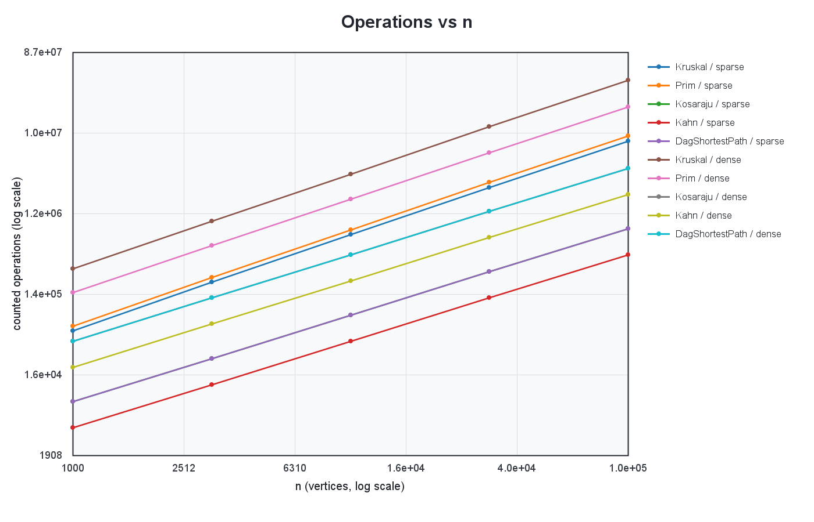
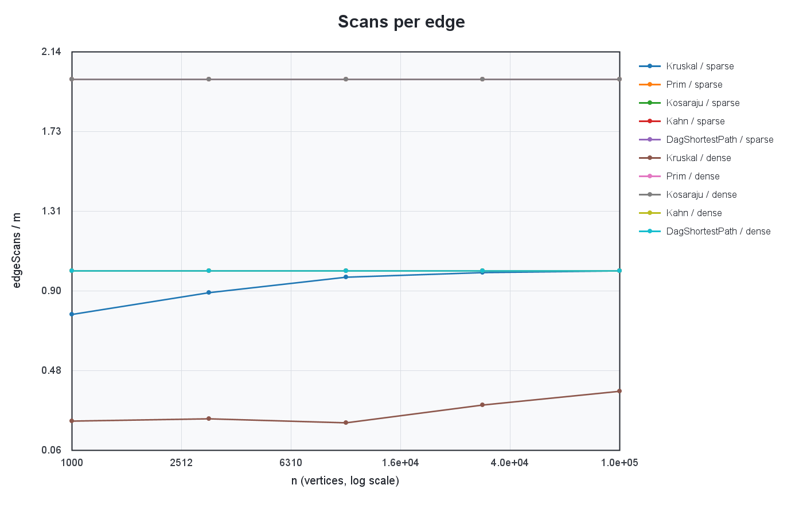
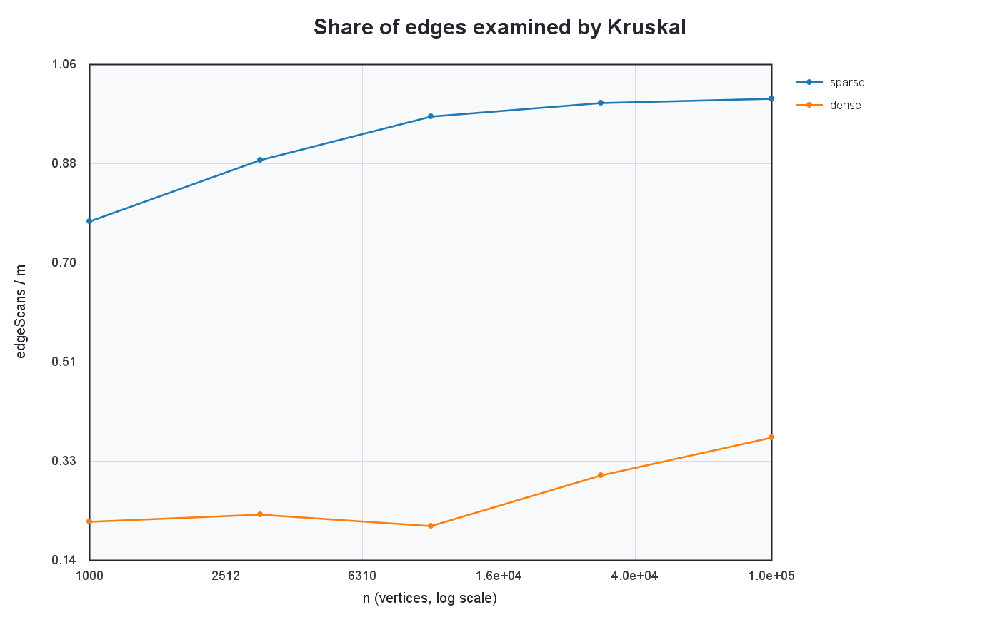

# Assignment 3 Report: Graph Algorithms

**Student:** Tamiris Mukieva 
**Group:** SE-2516

## 1. Methodology

The project uses one weighted adjacency-list graph representation for all
algorithms. Vertices are numbered from `0` to `n - 1`, weights are `int`, and
aggregate weights and distances are `long`. For every benchmark case, three
graphs are built: a connected undirected graph for Kruskal and Prim, a general
directed graph for Kosaraju, and a DAG for Kahn and shortest paths. Every new
graph starts from a fresh `Random(42)` and follows the generator call order
specified in the assignment. Each algorithm is run five times on the same
already-generated graph, and `time_ms` is the median. Counters are created
inside each run and are incremented at the operations they measure.

The recorded full run was produced on Windows 11 with an Intel Core i5-12450H,
8 GB of RAM, Microsoft OpenJDK 17.0.18, and Maven Wrapper 3.9.11. These details
make the timing context explicit; the deterministic seed, reference checks, and
operation counters remain the stronger reproducibility evidence.

The full experiment uses five sizes `1,000`, `3,162`, `10,000`, `31,623`, and
`100,000`. Each size has a sparse case `m = 4n` and a dense case `m = 20n`.
Before a row is accepted, the runner checks its MST weight, SCC count, or sum of
DAG distances against the supplied reference table. It also checks that
Kruskal and Prim agree, that Kahn returns a valid order, and that traversal edge
counts have their exact expected values. Therefore, a wrong algorithm stops the
benchmark instead of silently producing a plausible CSV file.

## 2. Complexity

| Operation or algorithm | Time | Extra space | Reason |
|---|---:|---:|---|
| DSU `find` / `union` | amortized `O(alpha(V))` | `O(V)` | Union by size limits tree growth and path compression flattens searched paths. |
| Kruskal | `O(E log E)` | `O(V + E)` | Sorting dominates; every tested edge then performs almost-constant DSU operations. |
| Prim with standard priority queue | `O(E log E)` | `O(V + E)` | Improvements add new candidates and stale entries are skipped, so the heap may contain `O(E)` entries. |
| Kosaraju | `O(V + E)` | `O(V + E)` | Two complete iterative DFS passes plus construction of the reversed graph. |
| Kahn | `O(V + E)` | `O(V)` | Each vertex enters the queue once and each directed edge is scanned once. |
| DAG shortest paths | `O(V + E)` | `O(V)` | One topological ordering and one relaxation pass over all outgoing edges. |

The inverse Ackermann function `alpha(V)` grows so slowly that DSU operations
are effectively constant for practical input sizes. Kruskal still has a
logarithmic factor because all edges must be ordered. This Prim implementation
may keep stale candidates, so its standard heap can grow to `O(E)`. The three
traversal-based computations are linear in the adjacency-list input size.

## 3. Counters and formulas

The CSV records four operation metrics that are independent of wall-clock time
for this fixed input and Java 17 implementation. `dsu_ops` is the number of
top-level `find` calls plus successful `union` calls. `edge_scans` counts an edge
at the moment an algorithm actually inspects it. `comparisons` counts
comparisons of weights or path costs, including comparator calls made by sort
and the priority queue. `max_depth` is the largest explicit stack size reached
by either iterative DFS pass of Kosaraju.

For `DagShortestPath`, `time_ms` covers the complete call: Kahn topological
sorting followed by relaxation. Its CSV counters deliberately describe only
the relaxation phase, as required by the assignment, so `edgeScans = m` rather
than `2m`.

The most direct checks are exact. Kosaraju scans every original edge in its
first pass and every reversed edge in its second pass, so `edgeScans / m = 2`.
Kahn scans every DAG edge once, and the relaxation pass also scans every DAG
edge once, so each has `edgeScans / m = 1`. Prim sees two adjacency entries for
each undirected edge, giving a ratio of `2`. Kruskal can stop as soon as the
connected generated graph has one component, so its ratio is at most `1` and
is often lower on a dense graph.

| Algorithm / measured counter | Normalizing formula | Observed full-run range |
|---|---:|---:|
| Kruskal DSU work | `dsuOps / edgeScans` | `2.13 .. 2.32` |
| Kruskal sorting | `comparisons / (E ln E)` | `1.29 .. 1.35` |
| Prim adjacency scan | `edgeScans / E` | exactly `2.00` |
| Prim priority queue, sparse | `comparisons / (E ln E)` | `1.57 .. 1.69` |
| Prim priority queue, dense | `comparisons / (E ln E)` | `0.54 .. 0.57` |
| Kosaraju two passes | `edgeScans / E` | exactly `2.00` |
| Kahn traversal | `edgeScans / E` | exactly `1.00` |
| DAG relaxation | `edgeScans / E` | exactly `1.00` |

Kruskal's `dsuOps / E` is not expected to be constant because early stopping
means it does not inspect every input edge. It ranges from `1.79 .. 2.25` on
sparse cases and `0.46 .. 0.79` on dense cases. Dividing by the number of
actually scanned candidates exposes the stable cost. On every connected
benchmark graph the exact identity is
`dsuOps = 2 * edgeScans + (V - 1)`: two finds per candidate and exactly
`V - 1` successful unions.

Prim's comparison ratio is also stable when density is held fixed. Sparse and
dense constants differ because the queue receives a different mixture of key
improvements and stale entries, while both retain the predicted `E log E`
factor.

For fixed density, `E` is proportional to `V`. A constant `edgeScans / m` as
`n` grows is therefore empirical evidence of linear traversal work. On log-log
axes, a linear function has slope `1`. Traversal series should be close to that
value, while Kruskal's total-operation series is expected to be slightly
steeper because sorting contributes `E log E` comparisons.

A least-squares fit on the five log-log points gives an edge-scan slope of
`1.00` for Kosaraju, Kahn, DAG relaxation, and Prim at both densities. The
Kruskal total-operation slopes are `1.10` for sparse and `1.09` for dense
graphs, which is the expected slight increase from sorting. Its scan-only
slopes are `1.05` (sparse) and `1.12` (dense); unlike a complete traversal,
Kruskal stops as soon as one DSU component remains, so this ratio also reflects
where the accepted low-weight edges occur. Thus the logarithmic factor is
shown most directly by `comparisons` and total operations, not by inventing a
post-hoc counter.

## 4. Correctness arguments

### 4.1 Cut property for Kruskal and Prim

Consider any cut that separates the vertices into two groups. The lightest edge
crossing that cut is safe: there exists a minimum spanning tree that contains
it. If a chosen MST does not contain the edge, adding it creates a cycle, and
that cycle contains another edge crossing the same cut. Replacing the other
edge by the lightest crossing edge cannot increase the total weight. Kruskal
applies this property to cuts defined by its current DSU components and adds the
lightest edge connecting two different components. Prim applies the same
property to the cut between the vertices already in its tree and all vertices
outside it. Repeating a safe choice until each connected component is spanned
produces a minimum spanning tree, or a minimum spanning forest when the input is
disconnected.

### 4.2 Induction on topological order for DAG shortest paths

Every zero-indegree vertex receives distance zero from the virtual super-source.
This is correct for the first vertices of a topological order. Assume that all
vertices before the current vertex have their final shortest distances. Every
path into the current vertex ends with an edge from one of those earlier
predecessors because all DAG edges point forward in topological order. The
algorithm has already relaxed every such incoming possibility, so the minimum
stored value is the true shortest distance. Relaxing the current vertex's
outgoing edges then supplies correct candidates for later vertices. By
induction, all distances are final after one pass. Negative weights are safe
because a DAG has no cycle that could lead back and reduce an already-final
distance indefinitely.

## 5. Which algorithm when?

| Situation | Preferred algorithm | Justification |
|---|---|---|
| Sparse undirected graph supplied mainly as an edge list | Kruskal | Sorting the compact list is direct, and DSU rejects cycles efficiently. |
| Dense undirected graph already stored by adjacency lists | Prim, with a caveat | It was faster in these runs and fits the representation, but this lazy version is still `O(E log E)`; the classic dense-graph advantage belongs to an `O(V^2)` array/matrix implementation. |
| Disconnected undirected graph | Either MST implementation | Both implementations restart or continue and deliberately return a minimum spanning forest. |
| Need all mutually reachable groups | Kosaraju | It finds every SCC in two linear, stack-safe passes. |
| A directed cycle may be present | Kahn first | The indegree queue either returns an order or proves that a cycle blocks DAG processing. |
| Graph is guaranteed to be a DAG | Kahn + DAG shortest paths | Topological order makes one linear relaxation pass sufficient, even with negative weights. |
| Directed graph may contain cycles and negative edges | Not the DAG method | A general method such as Bellman-Ford is required. |
| Very sparse traversal problem | Adjacency list | It uses `O(V + E)` memory instead of the `O(V^2)` space of a matrix. |

## 6. Empirical results and plots

The first chart uses log-log axes and separates every algorithm and density.
The operation curves increase predictably rather than depending on CPU speed.
The traversal algorithms follow near-linear growth, while the sorting and heap
work of the MST algorithms adds logarithmic overhead. The fitted traversal
slope is `1.00`; Kruskal's total-operation slopes are `1.10` (sparse) and
`1.09` (dense).

The second chart normalizes edge scans by `m`. The expected flat levels are
visible: `2` for Kosaraju and Prim, `1` for Kahn and DAG relaxation. This is the
counter-versus-formula confirmation of the corresponding `O(V + E)` scans.
Some curves lie exactly on top of one another because these ratios are equal;
fewer visible lines do not mean that a series is missing.

The third chart isolates `Kruskal edgeScans / m`. Kruskal does not need to test
all sorted edges after the generated connected graph becomes one DSU component.
The dense input offers more inexpensive alternatives, so the required spanning
tree is normally completed after a smaller share of the edge list.

The ten reference triples were reproduced exactly. In every case, Kruskal and
Prim had the reference MST weight, Kosaraju had the reference SCC count, and the
DAG relaxation had the reference sum of distances. The exact values are kept in
`ReferenceValues` and in the `result` column of `results/results.csv`, making the
claim directly reproducible rather than dependent on a manually copied table.

## 7. Timing limitations

Wall-clock times are included because they are useful practical observations,
but they are not the primary evidence for complexity. They depend on the CPU,
JVM compilation state, memory allocation, garbage collection, background load,
and other machine-specific effects. The smallest cases are especially noisy
because setup and timer overhead form a larger fraction of the measurement.
Using the median of five runs limits outliers but cannot make timings identical
across computers. Operation counters, fixed seed, exact scan identities, and
reference result checks provide the reproducible evidence used for conclusions.

The measured times grew with input size, and the largest dense case illustrates
the practical difference: Kruskal took `1224.63 ms`, Prim `413.87 ms`,
Kosaraju `635.79 ms`, Kahn `118.79 ms`, and DAG shortest paths `200.66 ms` on
this run. These figures describe this machine and run only; they do not replace
the operation-count evidence above.
